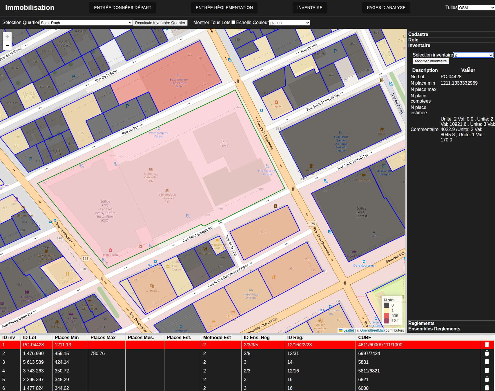
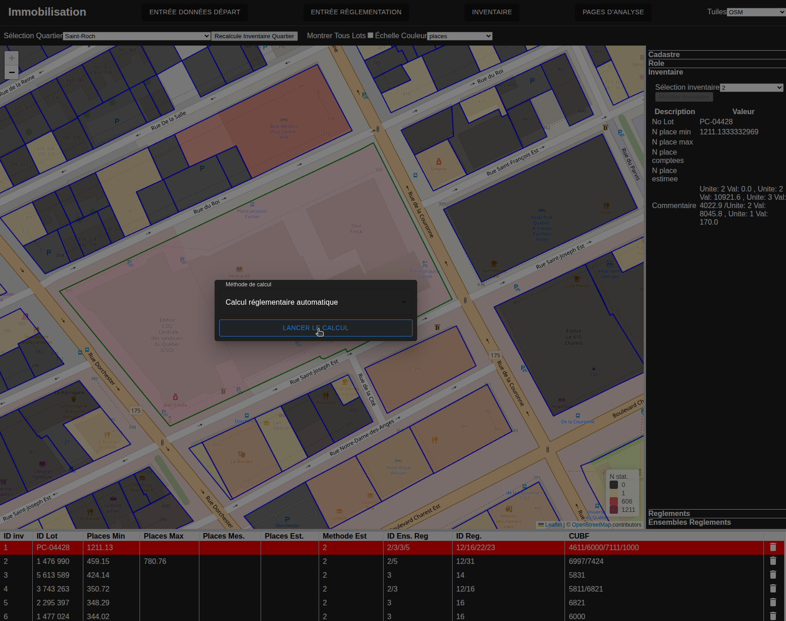
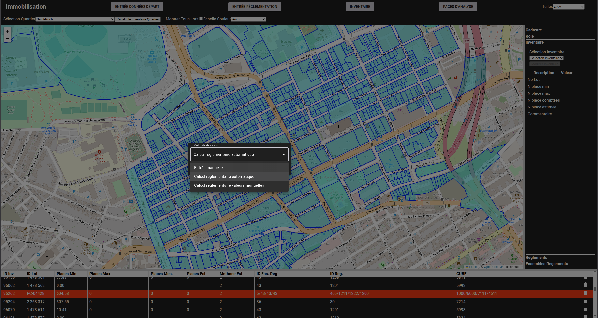
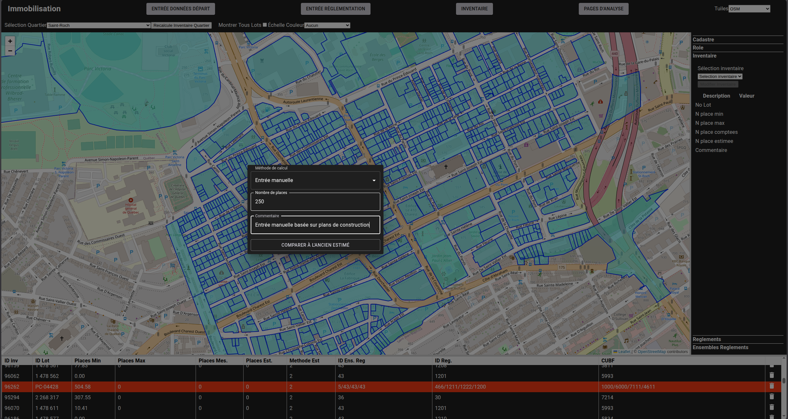
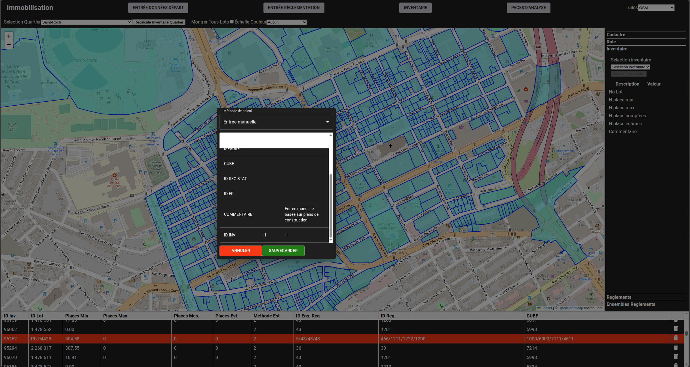
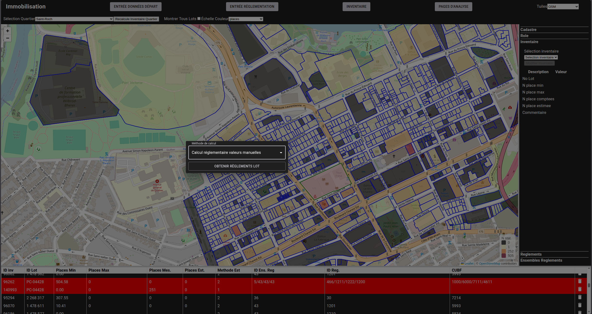
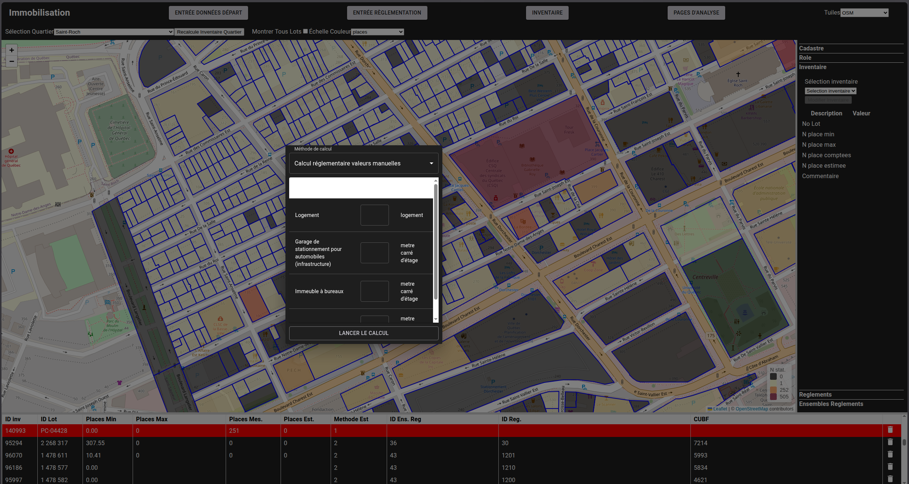

# Méthodes alternatives d'inventaire

---
[^Tables des matières](../../README.md)|[<Prediction par les minimums](040-Prediction.md)| 
[Evaluation des prédictions>](050-EvaluationPerformance.md)
---

L'outil permet de sauvegarder dans la base de données des inventaires avec des méthodes de calcul
alternatives. Cette section donnera une méthodologie pour créer ces types d'inventaire. 

## Méthode manuelle

L'analyste peut entrer un inventaire compté manuellement ou relevé à partir de plans de construction 
ou de sources tierces. Pour ce faire, naviguer à la page de manipulation d'inventaire montrée à la 
figure suivante et sélectionner un lot: 

Il faut ensuite sélectionner l'onglet inventaire dans la barre de droite et cliquer sur l'onglet
inventaire, puis cliquer sur modifier inventaire:

Un modal s'ouvrira alors qui permettra de sélectionner la méthode de calcul:

Sélectionnez alors l'option d'entrée manuelle dans la liste déroulante du modal:

Vous pouvez alors entrer le nombre de places et un commentaire. L'exemple ci-dessous 
parle de la provenance de l'estimé mais l'analyste peut entrer ce qu'il veut:

Une fois que vous cliquez sur sur "Comparer à l'ancien estimé". Une fenêtre comparant aux estimés 
manuels précédents s'affichera:

En cliquant sur sauvegarder, votre entrée sera sauvegardée et vous serez renvoyé à la page de modification de l'inventaire manuel. 

## Inventaire semi automatique

L'outil permet de créer des inventaires semi automatique. Dans ce cas, la règlementation est automatique choisie basée sur la date de construction et
la localisation et l'utilisateur peut alors spécifier les propriétés du bâtiment manuellement. La procédure est semblable à celle pour la création manuelle
puisque l'utilisateur va dans le même modal et choisit une option différente.

Cliquer sur le bouton obtenir règlements lots pour obtenir le formulaire d'entrées de données montré à la figure suivante. Il faut alors rentrer 
les valeurs pertinentes dans les lignes pour ensuite initier le calcul.

Une fois le calcul complété, une comparaison au calcul semi automatique précédent sera affichée comme pour les autres modes de calcul:

Il existe à l'heure actuelle quelques enjeux avec la méthode d'imputation qui sont résumés dans [un ticket](#150).
