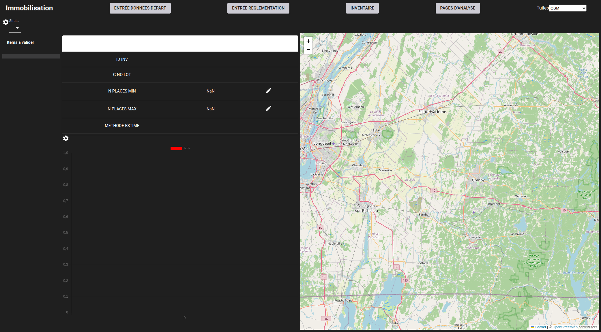
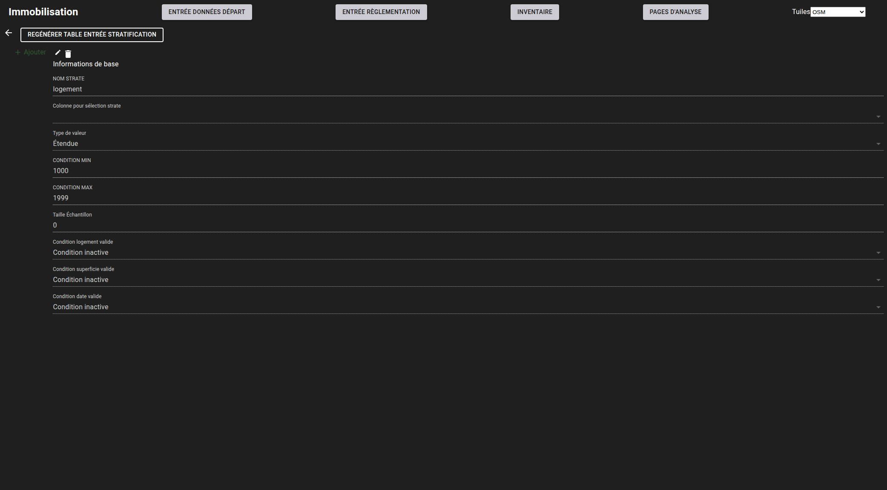
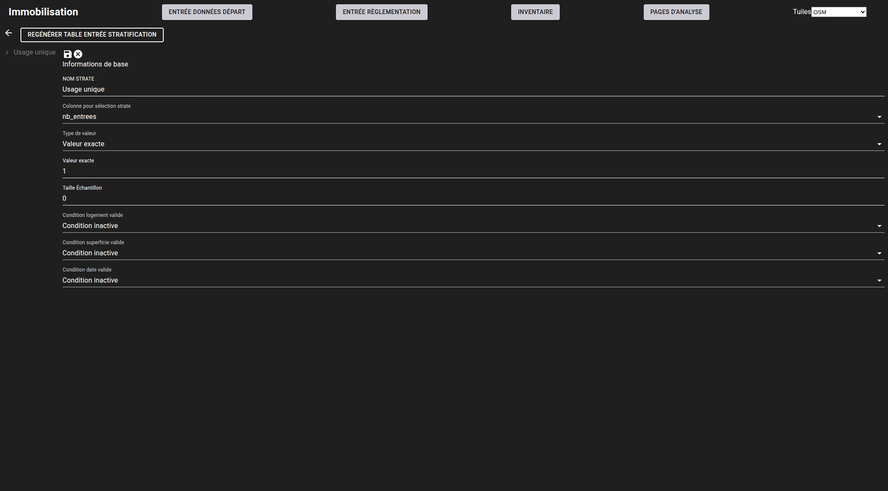
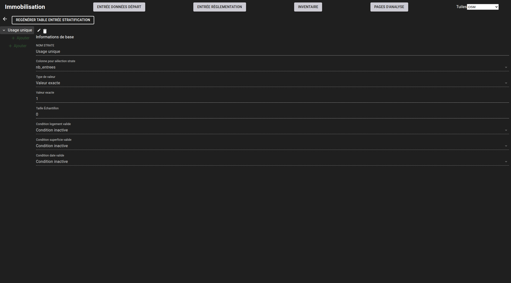
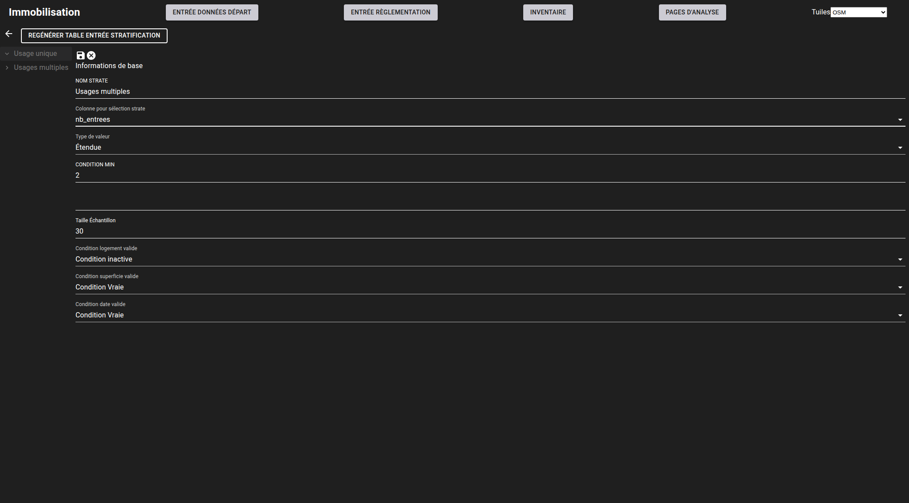
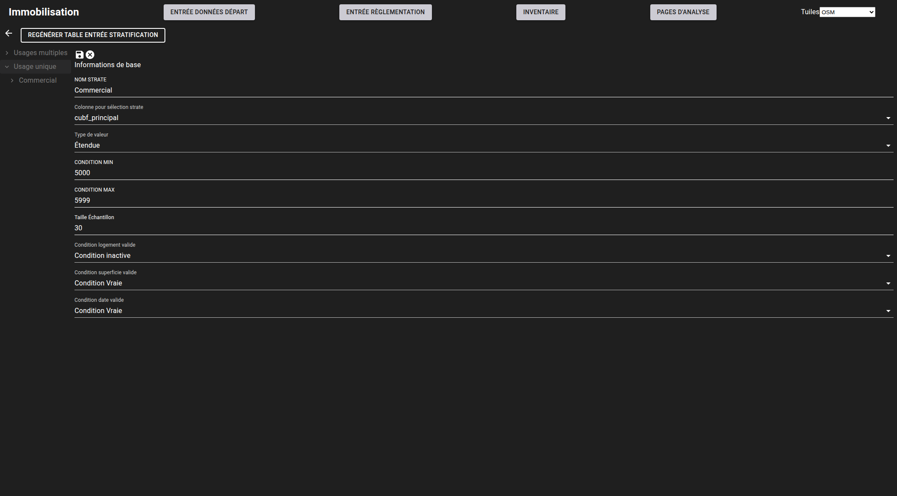
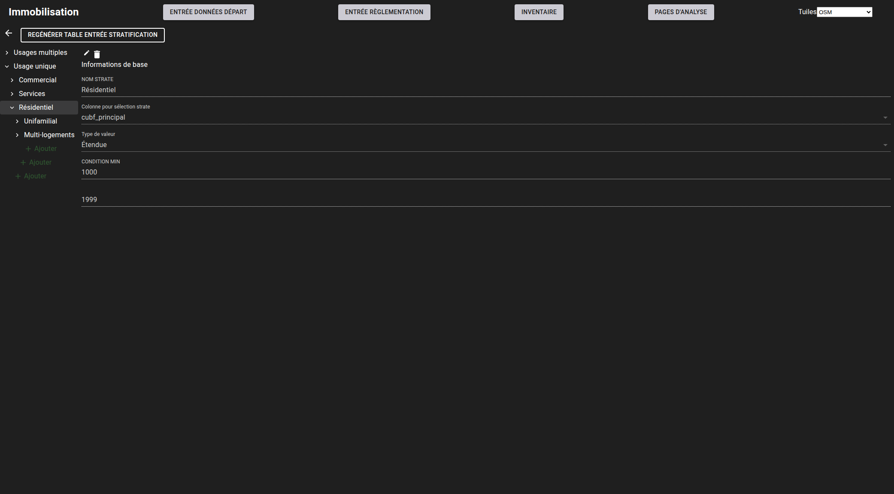

# Création des catégories

---
[^Tables des matières](../../README.md)|[<Évaluation des performances](051-EvaluationPerformance.md)|[Collecte des données>](052-CollecteDonnees.md)
---

La première étape de l'évaluation de performance est de segmenter l'échantillonnage entre plusieurs catégories. Pour l'instant, la segmentation
se fait seulement sur les variables du rôle foncier et ne permet pas de segmentation géographique. Cette page montrera comment créer les catégories 
d'évaluation de la performance. 

Pour ce faire, allez à la page d'évaluation des performances \<base-url\>/valid-stat. Si vous n'avez pas encore créé de catégories la page devrait 
ressembler à l'image ci-dessous.

En cliquant sur l'engrenage en haut à gauche de la page, vous accéderez à la page de création de strates d'évaluation qui est montrée à la figure ci-dessous:

En cliquant sur le symbole + en haut à gauche, on peut créer une nouvelle strate. Pour cet exemple, nous allons créer une stratification selon l'architecture 
suivante:

| ID | Nom de la strate | Colonne conditions | Type condition | Valeur | Valeur Basse | Valeur Haute| Enfant(s) de la strate |
|----|------------------|--------------------|----------------|--------|--------------|-------------|------------------------|
| 1  | Usage Unique     | Nombre usages      | Égal           |  1     |  S.V.        | S.V.        | [2,5,6]                |
| 2  | Résidentiel | Code utilisation bien-fonds | Intervalle | S.V.   | 1000         | 1999        | [3,4]                  |
| 3  | Unifamilial | Nombre de logements     | Égal           | 1      | S.V.         | S.V.        |                        |
| 4  | Multi-familial   | Nombre de logements| Intervalle     | S.V.   | 2            | S.V.        |                        |
| 5  | Commercial  | Code utilisation bien-fonds | Intervalle | S.V.   | 5000         | 5999        |                        |
| 6  | Services    | Code utilisation bien fonds | Intervalle | S.V.   | 6000         | 6999        |                        | 
| 7  | Usages multiples | Nombre usages      | Intervalle      | S.V.   | 2            | S.V.        |                        |

Après avoir appuyé sur le bouton pour ajouter une strate, la page changera de manière à changer les propriétés telles que montré à la figure suivante

Une fois la strate créée en cliquant sur la disquette, la liste permettra maintenant la création d'enfants tel que montré à la figure suivante. On peut
utiliser le bouton "+ Ajouter" du haut pour créer un enfant ou celui du bas pour créer une autre strate à la racine. 

Créons ainsi la strate à usages multiples. Dans ce cas, nous mettrons en place des conditions pour assurer que les entrées ont des données valides 
pour l'imputation du stationnement.

On peut maintenant créer la strate pour les usages commerciaux:

L'indentation dans la liste indique le lien de parenté entre les parents et les enfants. En cliquant sur le bouton d'ajout et en entrant les conditions logiques
on peut ainsi continuer à créer une stratégie. Il est important de noter que la stratégie actuelle ne permet pas valider que les conditions des strates ne se chevauchent pas. 

Une fois les strates complétées, il faut regénérer les tables d'affectation en appuyant sur le bouton "Regénérer table entrée stratification". Cette étape prendra un
peu de temps mais 