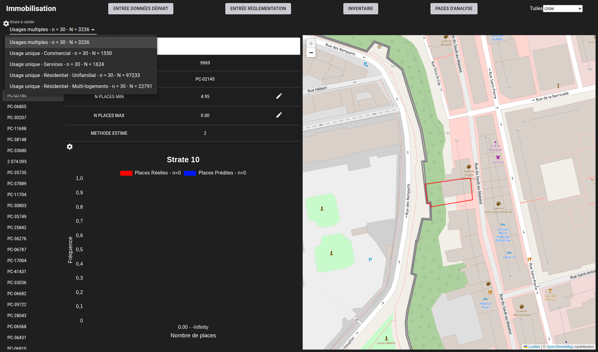
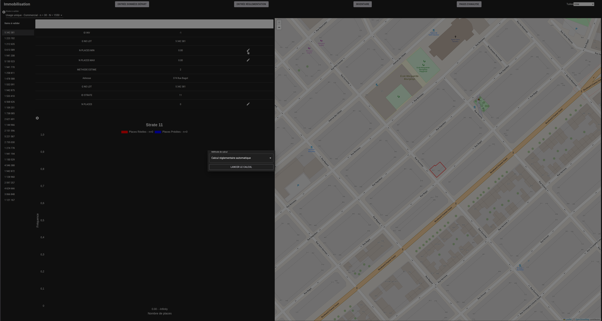
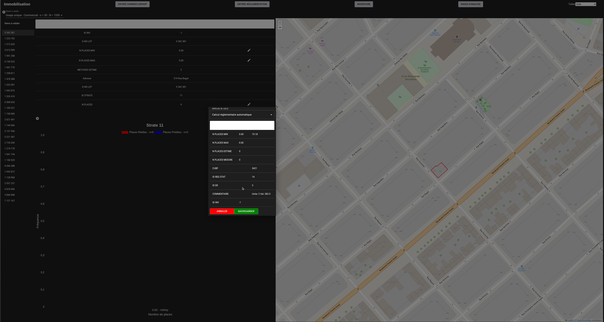
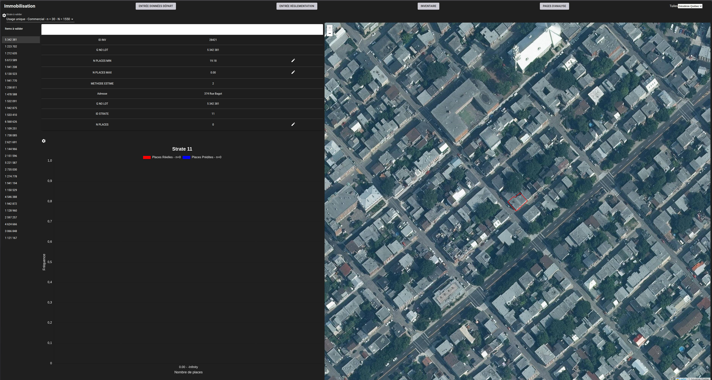
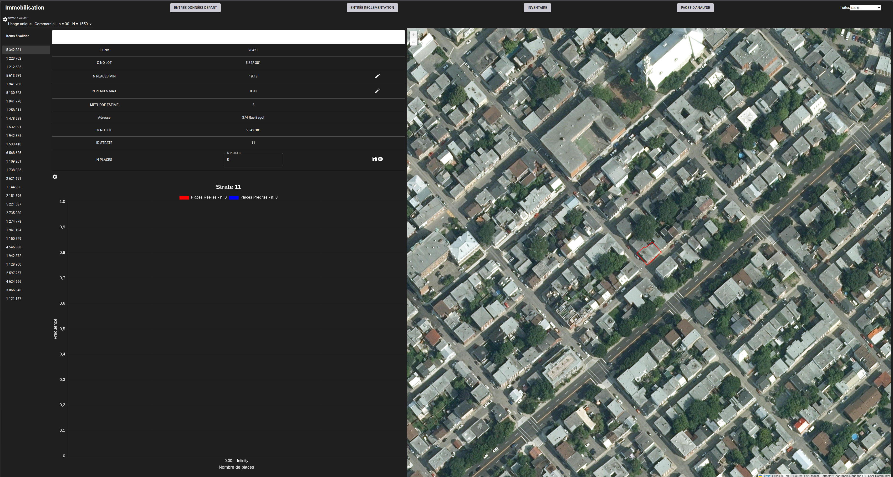
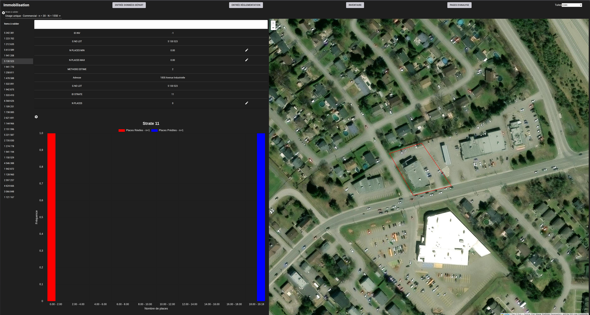
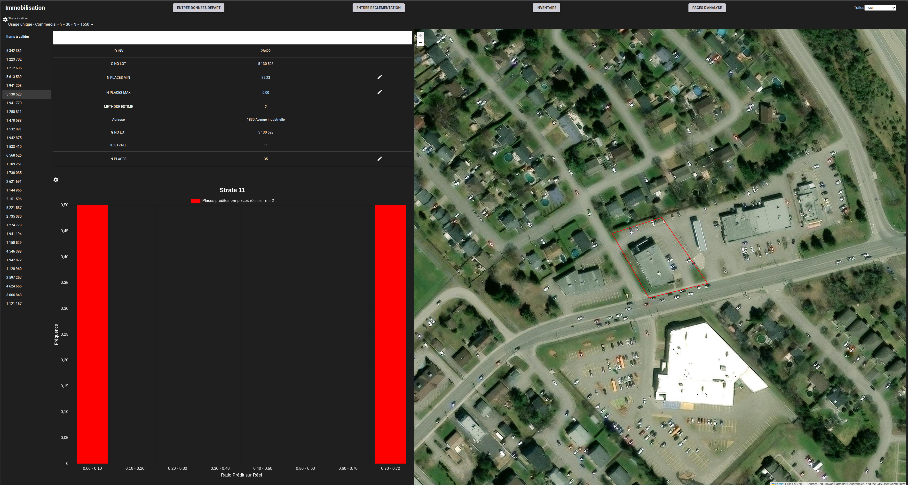
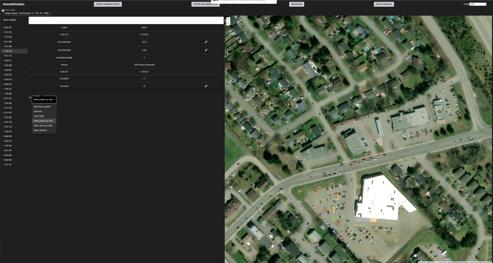

# Collecte des données 

---
[^Tables des matières](../../README.md)|[<Création des catégories](051-CreationCateg.md)|[Methodes d'évaluation>](053-MethodesEvaluation.md)
---

Maintenant que nous avons une structure de stratification, on peut retourner à la page de validation qui se situe à 
\<base-url>/valid-stat

Les feuilles des strates les plus basses de chaque branche devraient maintenant être disponibles dans la liste
déroulante en haut de la page tel que montré à la figure suivante:

En cliquant sur un des lots, il est possible de changer la carte sur le coté droit de la figure. La liste déroulante 
d'options de tuile en haut à droite permet de changer le fond de carte de manière à avoir différentes perspectives sur la même 
propriété. 

Les crayons à côté de chacun des estimés ou des mesures de stationnement permettre d'ouvrir une fenêtre modale pour éditer l'estimé. L'utilisateur peut 
ainsi demander de recalculer l'estimé avec la méthode automatique ou il peut aller éditer le nombre de places qu'il constate sur la propriété. 

On peut commencer par relancer le calcul en cliquant sur les crayons à côté de N places min et N places max, ouvrant le même modal que dans 
la visualisation de l'inventaire. Seule l'option de calcul automatique sera disponible dans ce module.  

En cliquant sur le bouton de calcul, on obtient l'estimé et une comparaison à la valeur présentement sauvegardée. Dans ce cas-ci, on constate qu'aucun inventaire n'avait été calculé.

Après avoir changé le fond de carte, on peut aller vérifier le nombre de places disponible sur le lot ou s'assister d'imagerie disponible au niveau de la rue. L'image suivante
montre le lot sélectionné avec un fond de carte d'imagerie aérienne;

On constate qu'il ne semble pas y avoir de stationnement. Il y a potentiellement des places dans un cour arrière mais le lot cadastral ne comprend pas cette section et 
les images au niveau de la rue ne montrent aucune porte de garage. On peut donc faire l'évaluation qu'il  y a zero place de stationnement sur ce lot. On peut alors 
cliquer sur le crayon à côté de n places et obtenir un champs de texte pour éditer le nombre de places et le mettre à zero. En cliquant sur le bouton de sauvegarde, on 
enregistre ce cas d'évaluation dans la base de données:

L'image suivante montre un cas un peu plus simple ou on voit clairement un stationnement ligné où l'on peut clairement discerner un nombre de places clair:

Après avoir relancé la prédiction et compté le nombre de places on constate que le nombre minimum de places et de 26 places contre une réalité terrain de 35 places. 
À mesure que l'évaluation de la performance se complète le graphique dans la moitié inférieur du panneau central se remplit. L'utiliateur peut changer la variable 
graphée en cliquant sur l'engrenage en haut à gauche du graphique. 

La figure suivante montre les options disponibles pour les variables à montrer sur le graphique inférieur:

Cela conclut la démonstration de la phase de récolte de données de validation.