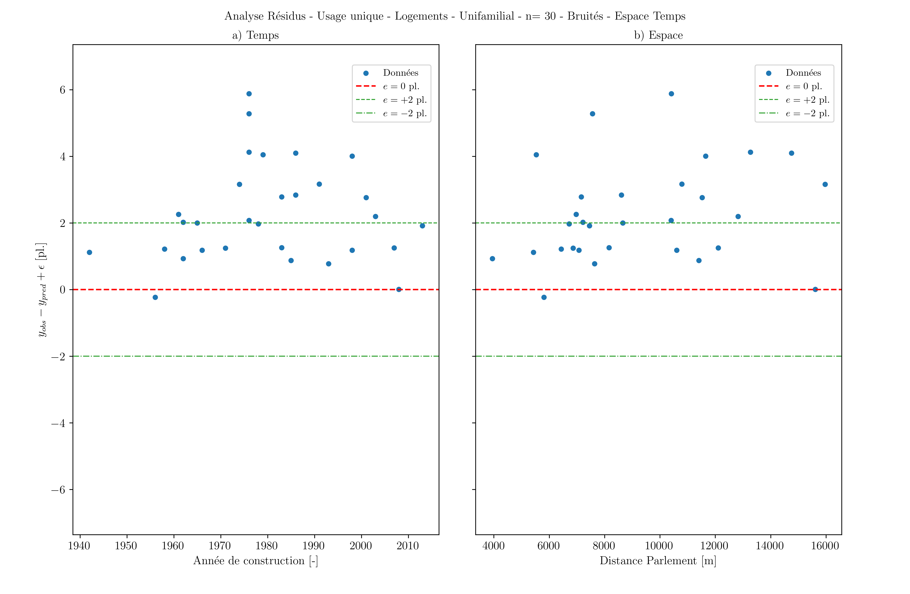
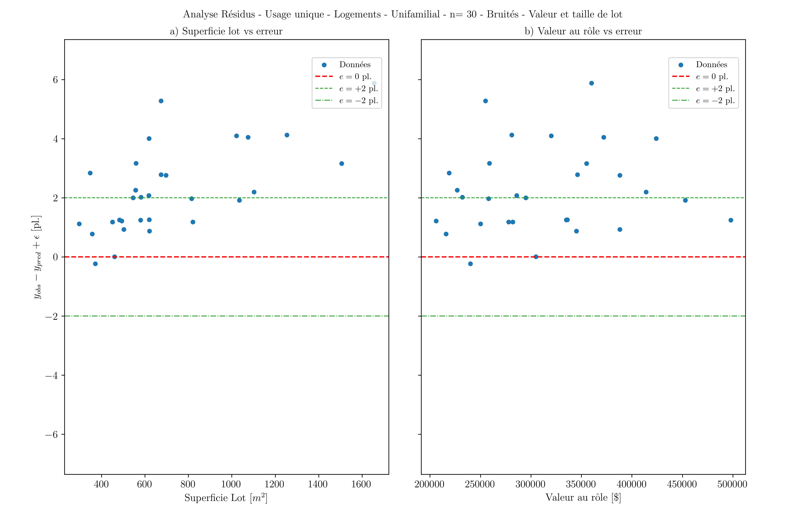
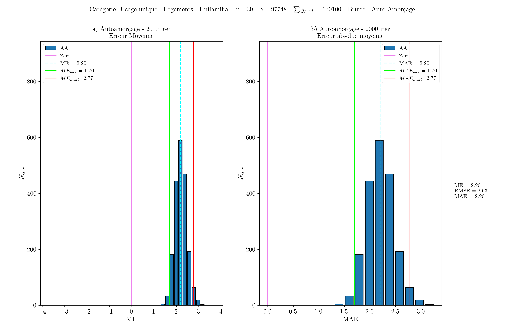

# Méthodes d'évaluation de la performance

---
[^Tables des matières](../../README.md)|[<Collecte des données](052-CollecteDonnees.md)|[Analyse de la mobilité>](060-Analyse.md)
---

Une fois les données récoltées, il est possible de faire l'analyse des données pour comprendre la validité des prédictions. Cette section réitèrera certains constats issus 
du mémoire qui a mené à l'élaboration de cette étude. Cette section est réalisée en dehors de l'outil dont le code est dans ce dépôt. Les figures sont issues de 
scripts qui sont entreposés au [lien suivant](https://github.com/epmpaulpoly/error_propagation).

De manière descriptive, la procédure d'évaluation de peformance proposée a deux composantes: la première consiste à faire une analyse des résidus, la deuxième consiste à 
calculer des métriques d'erreur et d'utiliser des méthodes d'auto amorçage(bootstrap) pour estimer des intervalles d'erreur pour ces métriques. 

## Analyse des résidus

L'analyse des résidus consiste à faire des graphiques montrant l'erreur(la différence entre le minimum prédit et la valeur terrain) en fonction de différentes variables. 
Cette approche est principalement qualitative à l'heure actuelle et illustre simplement des tendances (ou aucune tendance). Par inspection, le mémoire a fait plusieurs 
constats qui ne sont pas encore addressés dans l'outil:
    
- La conversion des unités mise en place tend à créer d'importantes erreurs que le modèle de données actuel rend difficile à atténuer
- Les minimums sont un mauvais prédicteurs dans les milieux résidentiels unifamiliaux. 
- Des valeurs haute de l'intensité de prédiction de stationnement sont un bon prédicteur d'importantes erreur. 
L'intensité de prédiction est définie par l'équation suivante $I= \frac{y_{pred}\times A_{lot}}{v_{lot}}$ où $y_{pred}$ est la quantité 
minimum de stationnement, $A_{lot}$ est l'aire du lot cadastral et $v_{lot}$ est la valeur au rôle foncier du lot.
- Certaines tendances spatiales d'erreur de prédiction sont visibles, la différence entre le minimum et la valeur constatée augmente à mesure 
qu'on s'éloigne du centre pour les ensembles résidentiels. 

La figure suivante donne un aperçu du résultat de l'analyse des résidus issu du mémoire pour quelques variables:

## Auto-amorçage et erreurs de prédiction

Les erreurs moyennes et erreurs absolues moyennes sont compilées pour chacune des strates d'évaluation. Une procédure d'auto-amorçage sur chaque strate est entamée qui 
permet de comprendre à quel point chacune de ces métriques aurait varié avec un échantillon différent. La figure suivante donne un aperçu du résultat:

Certaines propriétés de la distribution de l'erreur sont aussi montrés par les différents scripts. Les lecteurs intéressés devraient se réferrer au 
[mémoire](https://publications.polymtl.ca/72087/) pour plus de détails. 

## Discussion sur l'évaluation de performance

Il n'existe à l'heure actuelle aucune définition standard du niveau de précision requis pour avoir une estimation de l'offre de stationnement suffisament précise
pour pouvoir estimer l'effet de cette offre sur les comportements de mobilité. D'autre part, les processus d'évaluation de la performance peuvent parfois donner une
confiance dans la précision des prédictions qui n'est pas nécessairement transferable au contexte d'une autre étude. Les chercheurs et praticiens devraient donc utiliser
les données avec prudence, peu importe les résultats de l'évaluation
