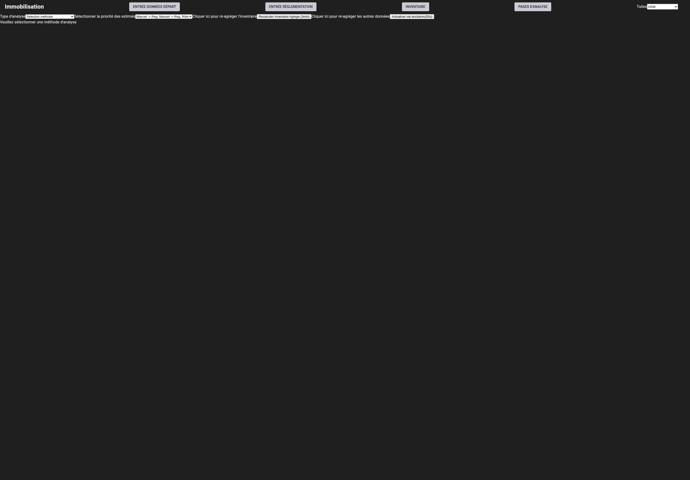
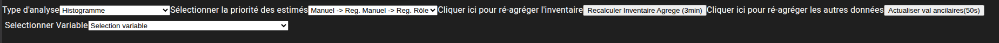
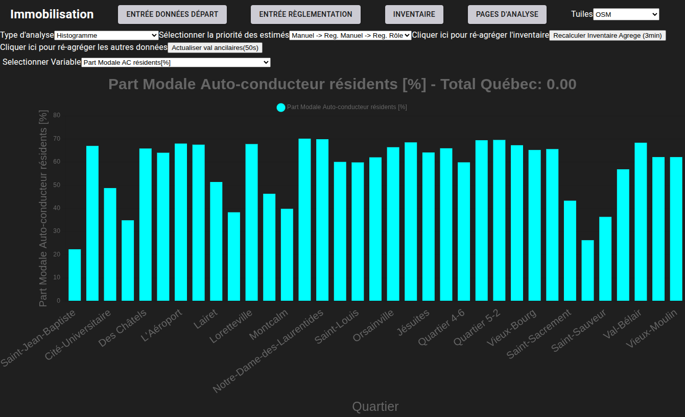

# Diagrammes à barre

[^Tables des matières](../../README.md)|[<Module d'analyse](060-Analyse.md)|[Diagrammes XY>](062-XY.md)
---

Le premier type de représentation des résultats est le diagramme à barres. Ces derniers sont toujours représentés en fonction
des noms des quartiers utilisés pour l'analyse. Pour y accéder, l'utilisateur doit naviguer à la page \<base-url>/ana-quartiers. La 
figure suivante montre la page à l'état brut:

Les deux listes déroulantes en dessous de la barre de menu principale permettent de sélectionner le mode d'affichage, la priorisation
des estimés pour un lot. Les deux boutons à leur droite servent à relancer l'agrégation de statistiques à partir des données brutes qui ont été
versé par l'analyste.
Une fois la méthode d'analyse sélectionnée, une autre liste déroulante apparait sous les deux premières qui permet de sélectionner la variable à afficher. La figure suivante montre le menu d'interaction pour les diagrammes à barre:

Une fois la variable sélectionnée, le graphique apparaitra, comme le montre la figure suivante:

La section suivante passera en revue les diagrammes XY
