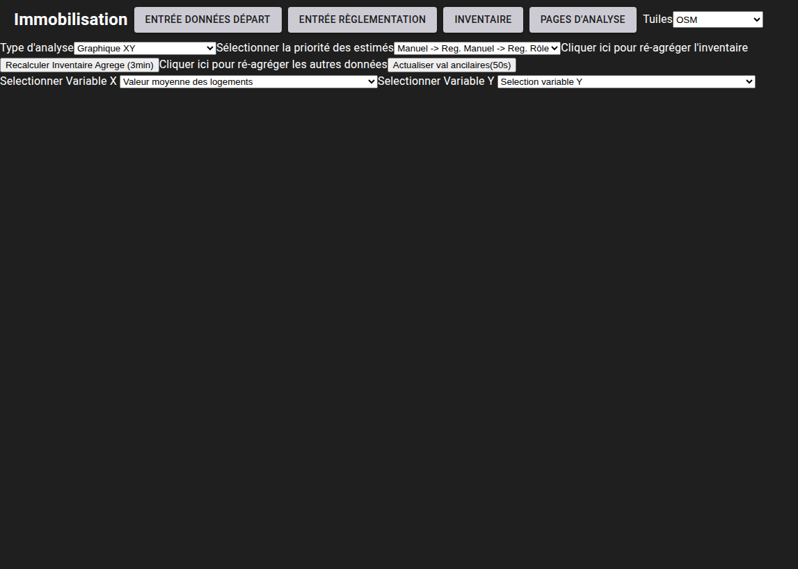
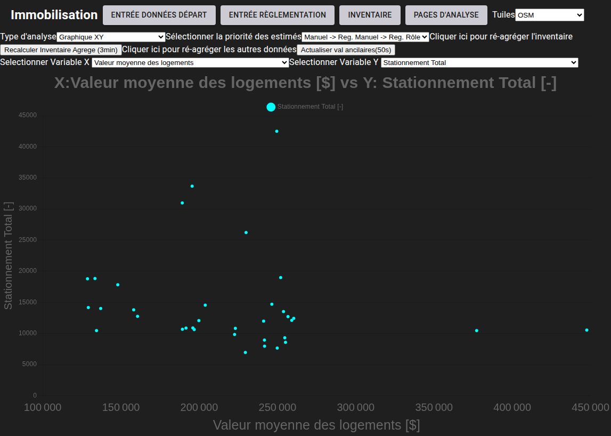

# Diagrammes XY

[^Tables des matières](../../README.md)|[<Diagrammes à barres](061-Barres.md)|[Cartes>](063-Carto.md)
---

Le deuxième type de diagramme sont les diagrammes XY. Le mécanisme est similaire où l'utilisateur navigue à la page 
requise \<base-url>/ana-quartiers et choisit l'ordonnancement de priorisation des méthodes d'estimation de l'inventaire. 
La figure suivante montre le menu pour l'option graphiques XY

Une fois les variables sélectionnées, le graphique s'affichera. La figure suivant donne un exemple

La prochaine section discutera des méthodes d'analyse cartographique.
