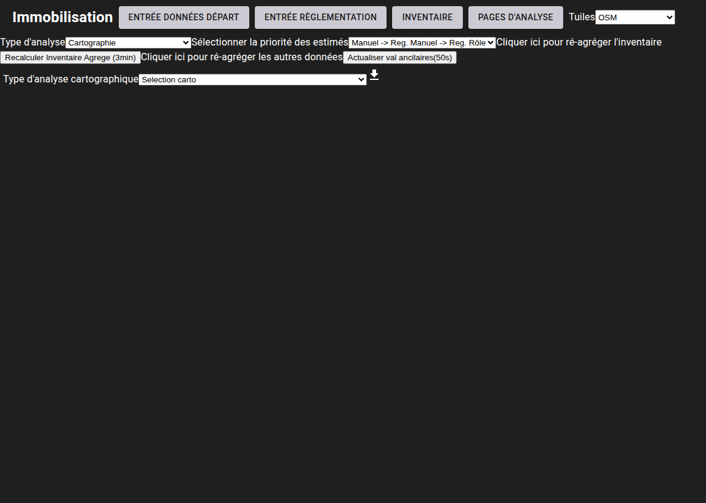
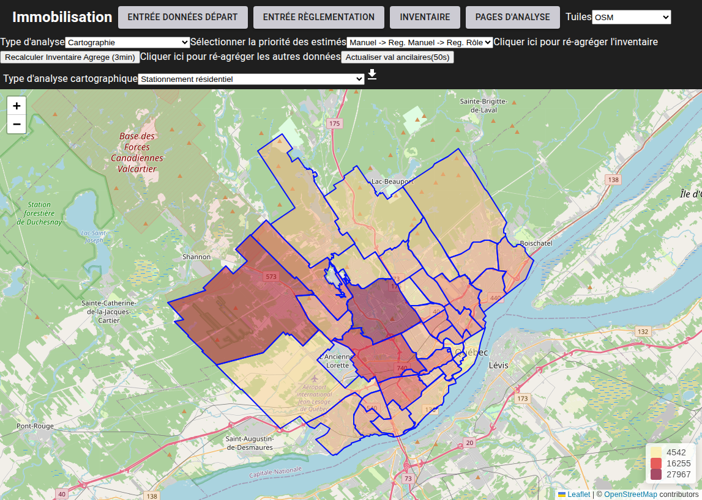

# Analyse Cartographique

[^Tables des matières](../../README.md)|[<Diagrammes XY](062-XY.md)|[Profils d'accumulation de véhicules>](064-ProfilAccumulationVeh.md)
---

La distribution spatiale des variables compilées peut aussi être visualisée sur des cartes choroplèthes à la même page \<base-url>/ana-quartiers . Le menu pour opérer les cartes est très similaire à celui pour les diagrammes à barres et est montré à la figure suivante

Une fois la variable sélectionnée la carte s'affichera remplissant le reste de la page:

La section suivante montrera l'utilisation de l'outil de profils d'accumulation de véhicules.
