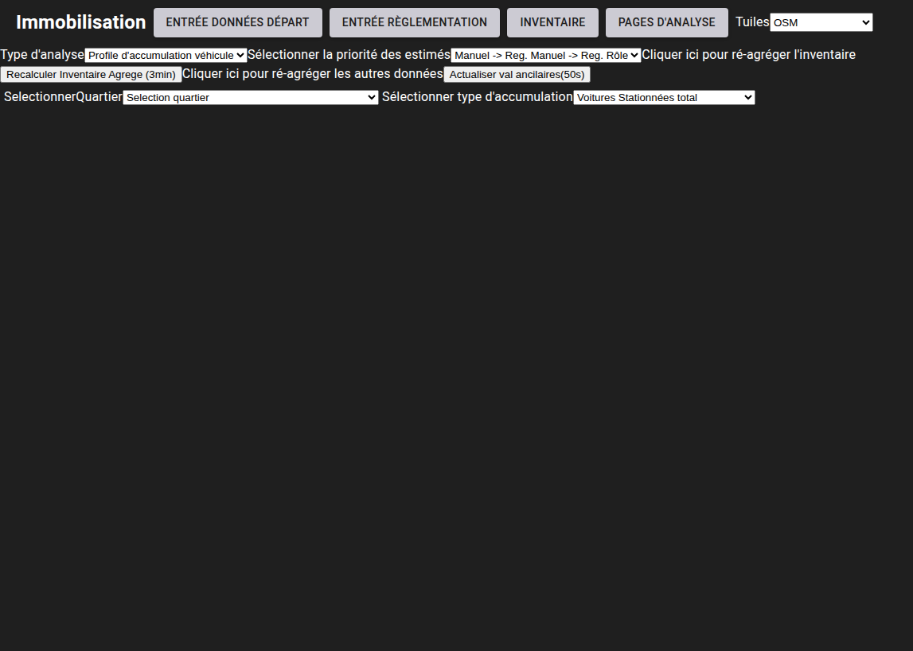
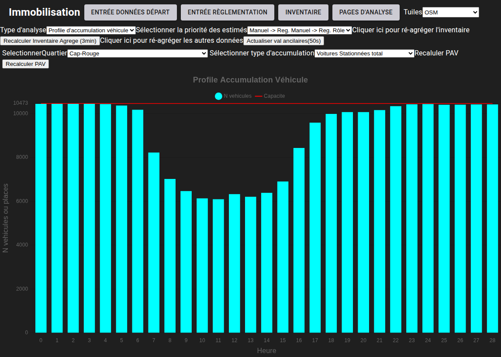
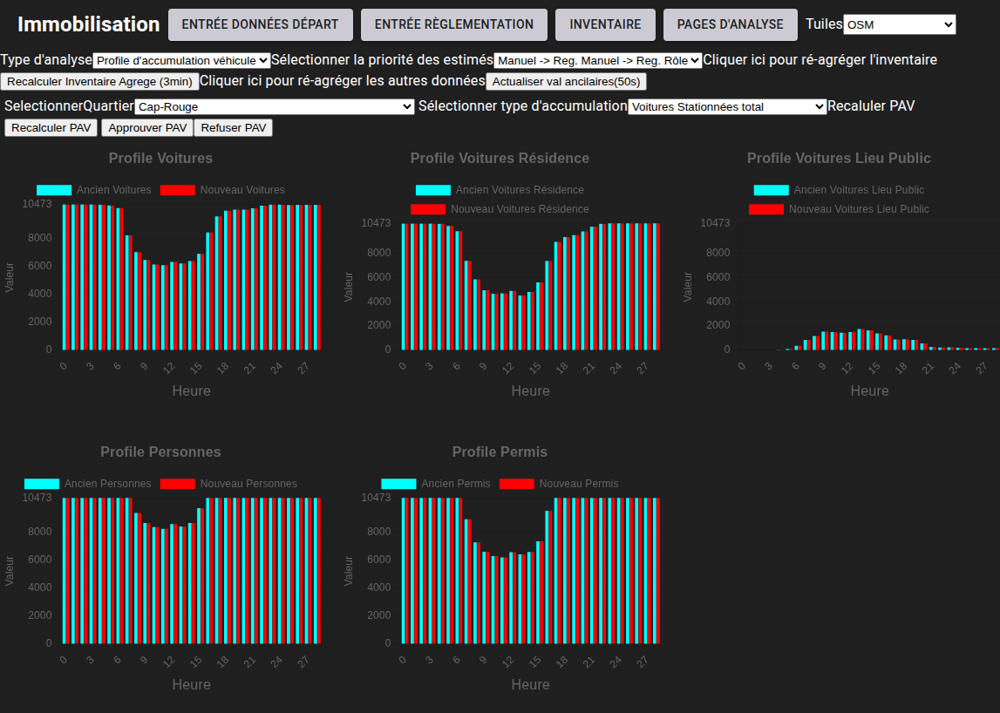

# Profils d'accumulation de véhicules

[^Tables des matières](../../README.md)|[<Cartographie](063-Carto.md)|[Analyse de variabilité>](065-AnalyseVariabilite.md)
---

Les profils d'accumulation de véhicules sont un moyen d'utiliser les données d'enquête OD pour comprendre le stock de véhicules dans une zone
géographique en fonction du temps qui a été développée par Morency et Trépanier(2008). Dans le passé, ces profils ont été utilisés comme méthologie pour inférer la capacité de stationnement dans 
la zone. Cependant, avec une estimation indépendante, il es possible comparer le nombre de véhicules estimés dans la zone d'intérêt avec la 
quantité de stationnement prédite. Comme pour les analyses présentées à date, il faut naviguer à la page d'analyse agrégée \<base-url>/ana-quartiers
et sélectionner l'option de profil d'accumulation de véhicules. La figure suivante montre le menu:

L'utilisateur peut ainsi choisir quel type de variable accumuler. Les choix sont les suivants:

| Variables qu'il est possible d'accumuler |
|------------------------------------------|
| Véhicules totaux                         |
| Véhicules stationnés à une résidence     |
| Véhicules stationnnés en public          |
| Personnes                                | 
| Permis de conduire                       |

L'utilisateur peut aussi sélectionner le quartier qu'il veut analyser. Une fois un secteur et une variable sélectionnée, le 
profile d'accumulation de véhicule s'affiche. 

En cliquant sur le bouton recalculer PAV, l'utilisateur peut calculer un profil d'accumulation véhicule et cette étape sera nécessaire lors 
de la première utilisation. Après que le calcul soit complété, l'utilisateur doit approuver le nouveau profile d'accumulation de véhicule. 
L'interface montrera les anciennes et les nouvelles valeurs. La figure suivante montre un exemple de cette comparaison:

Les deux boutons dans la barre de menu permettent d'approuver ou de rejeter les nouvelles valeurs.

La section suivante discutera de l'analyse de variabilité.

--

Morency, C., & Trépanier, M. (2008). Characterizing parking using Travel survey data (CIRRELT-2008-15; p. 24). CIRRELT. https://www.cirrelt.ca/documentstravail/cirrelt-2008-15.pdf
